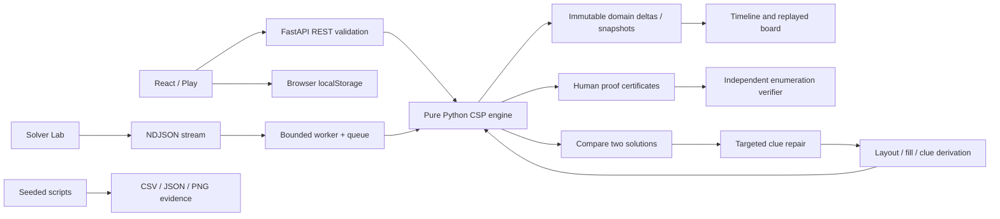
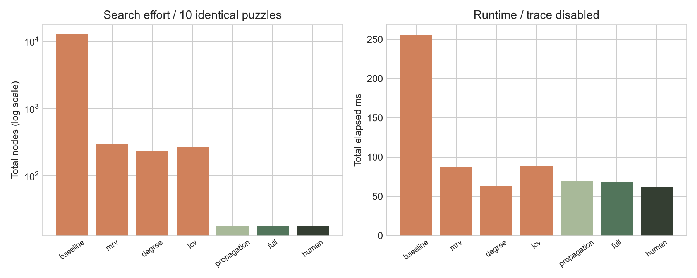
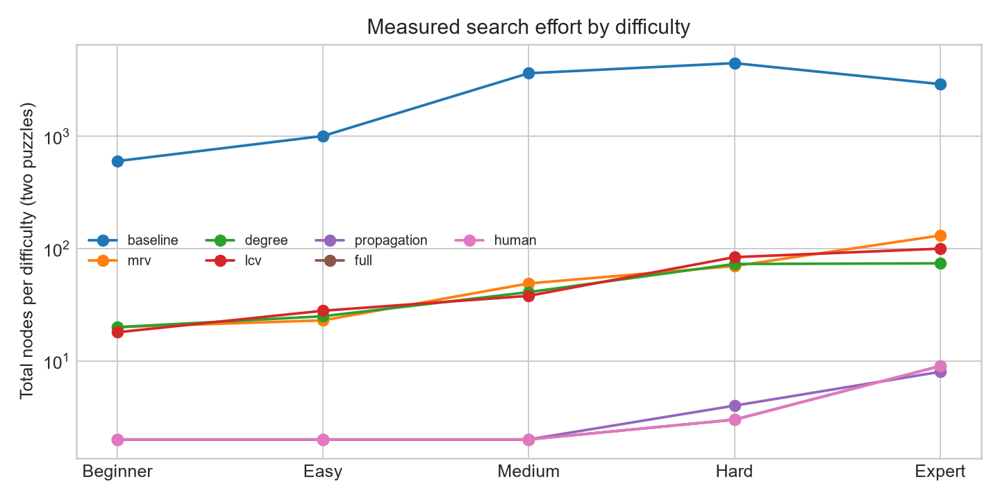
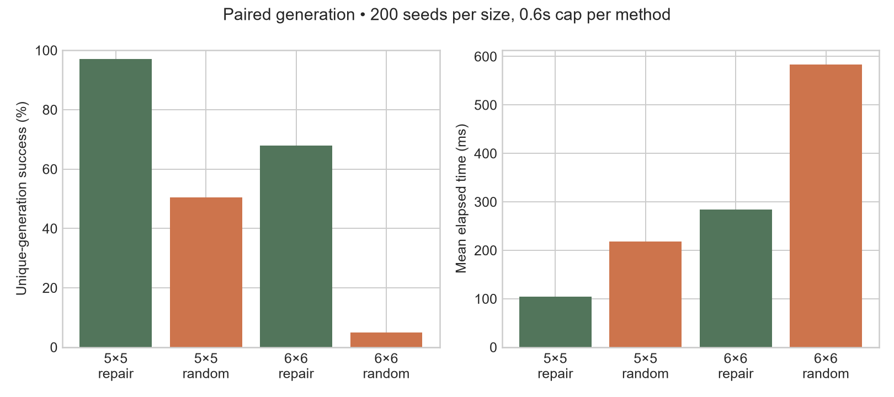
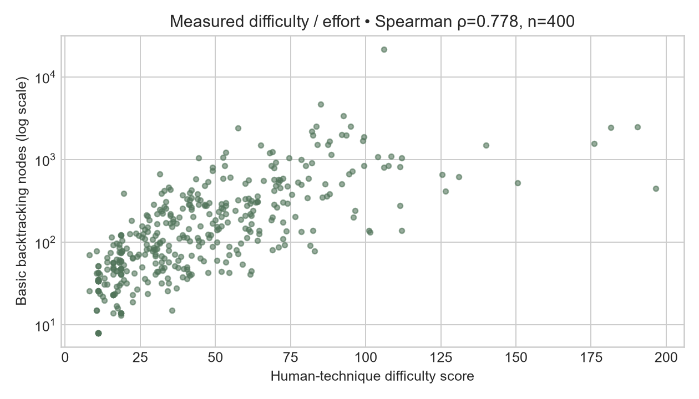

# Kakuro AI Lab

### Small cells. Deep reasoning.

Kakuro AI Lab is an offline, explainable constraint-satisfaction platform: a playable puzzle room, a live solver laboratory, a fair strategy arena and an ambiguity-guided generator. Its two research contributions are **proof-carrying human-technique deductions with bounded shortest-conflict diagnosis**, and **solution-disagreement-guided clue repair with behavior-based difficulty**. Every decision, elimination, branch and benchmark comes from a custom pure Python engine. React makes that reasoning inspectable and reversible; FastAPI connects the two without external AI services.

## 1. Problem statement and motivation

A solved grid hides most of the intelligence needed to obtain it. A normal puzzle game tells a player whether a digit is right; a normal solver often returns only an answer. Neither makes it easy to understand why a candidate disappeared, why a branch failed or why one search heuristic helped.

Kakuro is a useful AI laboratory because small local constraints interact through shared variables. Each white cell must satisfy a horizontal sum and a vertical sum simultaneously, while each run also forbids repeated digits. Local legality does not guarantee global consistency. This provides concrete examples of representation, inference, heuristics, search, contradiction and empirical evaluation without requiring a neural model or paid API.

## 2. Objectives

- Make a complete Kakuro game usable with mouse, keyboard and touch-sized controls.
- Compare fixed-order backtracking, MRV, degree, LCV and propagation on identical inputs.
- Explain real domain changes and reconstruct any recorded search state.
- Carry independently checked local proofs with human deductions and identify wrong-entry conflicts.
- Generate unique puzzles by using two solutions to locate and repair ambiguity.
- Measure difficulty from solving behavior, then evaluate it against actual search effort.
- Provide reproducible source, data, tests and presentation material, with explicit limitations.

## 3. Kakuro rules and a worked example

Fill every white cell with a digit from 1 to 9. Each consecutive white run must add to its clue; digits cannot repeat **within that run**. The same digit can appear in other runs. Clue cells have a diagonal split: the top-right number is the sum across, the bottom-left number is the sum down.

This small complete example is also a hand-checked test fixture:

| | ↓ 4 | ↓ 6 |
|---|---:|---:|
| → 3 | 1 | 2 |
| → 7 | 3 | 4 |

Across 3 in two cells permits only the set `{1,2}`. Down 4 in the left column permits `{1,3}`. Their intersection forces the top-left cell to 1; the other three values follow. A digit 9 in the top-left cell immediately contradicts the across-3 clue. A digit 2 there is locally legal, but cannot extend to the unique full solution. The Play page distinguishes these two mistake classes without automatically exposing the solution.

## 4. Kakuro as a constraint satisfaction problem

For white cells `V`, define a variable `X_rc` for each coordinate `(r,c)` with domain `D_rc ⊆ {1,…,9}`. For every horizontal or vertical run `R` with clue `t_R`:

```text
Σ X_i = t_R               for i ∈ R
AllDifferent(X_i : i ∈ R)
X_i ∈ {1,2,…,9}
```

Each variable belongs to exactly one across and one down run. The model stores ordered scopes, clue targets, clue coordinates, cell-to-run maps and neighbor relationships. The initial domain is all nine digits, except player-supplied assignments. Distinct digit sets are cached by `(run length, target sum)`. A run's domain-compatible ordered tuples provide exact support for candidate pruning.

The JSON boundary is deliberately simple:

```json
{"rows":3,"cols":3,"cells":[
  [{"type":"black"},{"type":"black","down":4},{"type":"black","down":6}],
  [{"type":"black","across":3},{"type":"white"},{"type":"white"}],
  [{"type":"black","across":7},{"type":"white"},{"type":"white"}]
]}
```

Rows/columns must match the matrix. Runs have length 2–9, feasible distinct-digit sums and a preceding clue. Every white cell has both memberships, and the white-cell constraint graph is connected. Complete solutions are validated against all rules before being returned.

## 5. System architecture and data flow



| Module | Responsibility |
|---|---|
| `backend/app/core/model.py` | Parse and validate the board; construct the constraint graph |
| `solver/constraints.py` | Cache digit sets; enumerate exact supported tuples |
| `solver/engine.py` | Seven strategies, bounded search, metrics and events |
| `solver/techniques.py` | Ranked human deductions with captured premises |
| `solver/verifier.py` | Independent proof enumeration and trace-state integrity |
| `solver/diagnose.py` | BFS contradiction chains, minimum clue core, escalating hints |
| `solver/replay.py` | Domain reconstruction and deterministic explanation wording |
| `generator/generate.py` | Seeded layout, valid fill, uniqueness and ambiguity repair |
| `generator/difficulty.py` | Trace-derived score and per-size empirical thresholds |
| `backend/app/main.py` | Validated REST endpoints and worker-backed NDJSON streaming |
| `backend/app/arena.py` | Equal-input, equal-limit, trace-free comparisons |
| `frontend/src/store.js` | Pure undo/redo and replay operations; safe local persistence |
| `frontend/src/hooks/useGame.js` | Timer, saved sessions, debounced checks and completion history |
| `frontend/src/components/` | Accessible board, timeline, search tree and common UI |
| `frontend/src/pages/` | Six coherent product destinations |
| `scripts/` / `results/` | Reproducible experiments and recorded evidence |

The frontend sends JSON to the API. The API validates structure, then calls the pure engine. A solver worker emits actual events through a bounded queue; React incrementally receives them and reconstructs domains. Candidate removals are deltas; initialization, restoration and solved events include snapshots. Playback therefore reproduces both successful and failed branches. The API cancels streamed work after client disconnection. No UI imports enter the engine.

Saved entries, notes, undo/redo stacks, timer, completed-game history and the most recent arena results stay in browser localStorage. Generated games use puzzle-content identity so two different outputs cannot accidentally share saved entries. Built-in witness solutions remain server-side until an explicit reveal/solve request.

## 6. Algorithms, simply explained

All configurations implement the same bounded interface and return a validated solution, solution count, status, metrics and optional trace. `limit` is distinct from `unsatisfiable`. `unique` is returned only after enumeration with a solution limit of at least two finishes with one solution. Reaching two proves `multiple`. Finding one while counting stops early only establishes `solved`.

### Basic backtracking

**Intuition:** choose the first unassigned cell, try a digit, reject partial duplicate or sum-bound violations, and undo a failed choice. **Example:** if a two-cell sum-3 run starts with 9, reject that branch immediately.

```text
search(state):
  if any run is inconsistent: return
  if all cells assigned: validate all rules; record solution
  else:
    x = first unassigned cell in row order
    for v in 1..9:
      search(copy(state) with x=v)
```

Worst-case time is exponential, `O(9^n)` search states with run-check overhead. Copying domains at each child provides straightforward, correct restoration. Baseline does not quietly perform full propagation.

### Minimum Remaining Values (MRV)

**Intuition:** confront the hardest immediate choice first. Compute currently legal moves without mutating domains; choose the smallest set. **Example:** pick a cell with `{2,7}` before one with `{1,3,4,6}`.

```text
legal[x] = digits consistent with x's two runs
x = argmin size(legal[x]) among unassigned cells
```

Selecting a variable adds candidate/run-check work per node. Worst-case search remains exponential; fewer nodes are an empirical outcome, not a guarantee.

### Degree tie-break

**Intuition:** when MRV ties, choose the cell constraining the most remaining neighbors. **Example:** between two size-2 domains, prefer the cell sharing runs with six unassigned neighbors over one sharing with two.

```text
x = argmin (legal-domain size, -unassigned-neighbor count, row order)
```

Graph-based degree counting adds roughly neighbor-set work per selection. It changes ordering, not the set of legal solutions or exponential worst-case complexity.

### Least Constraining Value (LCV)

**Intuition:** try the value that removes the fewest legal neighbor choices. For each tentative digit, count neighbor candidates made inconsistent by the run constraints. **Example:** if 2 rules out one neighbor value and 7 rules out five, try 2 first.

```text
impact[v] = count of neighbor values inconsistent after x=v
try values ordered by (impact[v], digit)
```

The look-ahead costs additional constraint evaluations, approximately domain × neighbors × neighbor-domain work per selection. It can increase total runtime or even lead to more nodes on an individual puzzle. The measured arena includes such cases.

### Constraint propagation

**Intuition:** keep a digit only if it appears in some complete legal tuple for each of the cell's runs. Repeat because removing a candidate can invalidate support in an intersecting run. **Example:** across-3 gives `{1,2}`; crossing down-4 gives `{1,3}`; the intersection forces 1.

```text
repeat until no domain changes:
  for each run R:
    T = all distinct-digit tuples satisfying sum(R) under current domains
    if T is empty: contradiction
    for cell i in R: D[i] = D[i] ∩ values at position i in T
```

This is generalized arc consistency for the joint run-sum and AllDifferent relation. A length-k run has at most `9!/(9-k)!` ordered tuples. Tuple materialization can dominate runtime. Propagation-only retains fixed cell order; Full CSP also uses MRV, degree and LCV. Neither makes worst-case search polynomial.

### Human Logic solver

**Intuition:** use the easiest applicable named human deduction before guessing. Every application captures its exact premises and conclusion. If the catalogue reaches a fixed point, choose a search variable with MRV/degree and values with LCV; explicitly mark that choice as an assumption.

```text
while an applicable technique exists:
  choose the lowest-rank application
  capture clue/domain premises and reduced domains
  emit certificate; apply reduction
  if a domain becomes empty: contradiction
if unfinished: branch with MRV + degree + LCV
```

It shares CSP search's exponential worst case. Independent proof checking costs extra enumeration and is excluded from arena solve timing. A local proof is conditional on prior branch assumptions; a guess is never labeled a proved deduction.

## 7. Novelty 1 — reasoning with receipts

### The problem

A plausible explanation string does not establish that a candidate removal was valid. A useful explanation must expose the state used, make the conclusion checkable and distinguish inference from a search assumption.

### Technique catalogue

| Rank / weight | Technique | Sound deduction |
|---:|---|---|
| 1 | Unique-combination run | Restrict to the only distinct digit set for length and sum |
| 2 | Min/max bounds | Remove digits outside attainable remaining-sum bounds |
| 3 | Combination-set pruning | Restrict to the union of still-feasible digit sets |
| 4 | Run intersection | Intersect the two run-level digit-set possibilities |
| 5 | Naked pairs/triples | An n-cell domain union of size n reserves those digits in that run |
| 6 | Hidden single | A digit required by every feasible combination has exactly one candidate location |
| 7 | Cross-run combination elimination | Remove values without exact support after intersecting crossing-run tuple information |

Hidden singles require that the digit be mandatory in the run, since Kakuro does not require every digit 1–9 to appear. This distinction prevents importing an unsound Sudoku rule.

Each certificate contains `technique`, `rank`, `runs`, `cells`, `premises.domains`, `premises.constraints` and `conclusion`. The premises record the exact current candidate sets and clue scopes/targets. The conclusion records the reduced domains. A separate module, importing no technique implementation, brute-force enumerates the premises and checks that every deleted candidate lacks support.

The full verifier additionally checks initialization against supplied entries, binds clues to the actual board, validates branch/assignment transitions, checks exact parent restoration and validates solved snapshots. A valid prefix cannot authenticate a fabricated later forced digit. The UI reports verified deduction/forced-assignment steps separately from assumptions; corrupted proof and mutation regression tests exercise this boundary.

### Worked proof and conflict

In the example grid, across-3 over two cells allows only `{1,2}`. A certificate begins with both domains `{1,…,9}` and concludes both are `{1,2}`. Independent enumeration finds `(1,2)` and `(2,1)`; therefore every removed digit is unsupported. Down-4 then intersects the left cell to `{1}`. The forced assignment follows from a real domain reduction.

If the player supplies 9 in the first cell, BFS finds a contradiction in one step: there is no other distinct positive digit that can make the across total 3. A minimum-cardinality clue-core search can certify that **one clue** suffices, conditioned on that supplied entry; zero clues impose no sum contradiction.

For harder mistakes, breadth-first search explores technique applications until the first contradiction is dequeued. This proves shortest deduction length **within the implemented catalogue**, including the terminal contradiction. A separate exact subset search finds a minimum number of conflicting clue constraints under fixed player entries, if it completes. It does not claim a minimum joint set of clues and entry assumptions. Both searches return an explicit inconclusive result when their budgets expire.

### Escalating help and replay

Hints progress from run nudge, to easiest technique name, to a cell reveal established by uniqueness checking. The first levels never reveal a solution. Check board distinguishes immediate rule violations from global incompatibility. Reveal cell, across run and complete solution are explicit actions; full reveal asks for confirmation.

The lab shows real domain initialization, constraint evaluation, candidate elimination, assignment, heuristic selection, branching, contradiction, backtracking, technique application and solved events. Before/after domains, affected scopes, reasons, MRV candidate counts, degree and LCV impacts remain inspectable. Beginner, Technical and Research wording is deterministic. Playback supports play/pause, forward/back, speed, first/last and event-slider jumps. The search topology visualizes actual branch depths; a deduction-only solve correctly has no search tree.

The contribution is the **checkable connection between explanation and state**, plus bounded shortest conflict analysis, rather than an attractive log of unverifiable prose.

## 8. Novelty 2 — use ambiguity as a signal

### The pipeline

1. Sample a connected white-cell mask and remove singleton fragments. Validate every run and membership.
2. Randomly color cells with digits absent from both intersecting runs.
3. Derive every clue from that legal witness fill.
4. Run the custom solver with solution limit two.
5. If two solutions exist, compare them to find disagreement cells.
6. At a disagreement cell, edit the witness to a digit absent from its neighbors, update the two affected clue sums and re-count.
7. Accept only after complete enumeration establishes uniqueness; solve with Human Logic to rate difficulty.

Repairs favor edits with fewer valid digit combinations in the affected runs and avoid previously visited witness fills. They are targeted one-cell witness edits affecting two clues; they are **not** claimed to be globally optimal minimum-edit repairs. If no legal edit works or budgets expire, generation may restart or return no verified puzzle. Target difficulty mismatches remain visible instead of being relabeled.

**Generation reliability update:** grids 7–12 use connected, randomized short-run layouts. If random repair attempts yield no rated unique puzzle, a reserved part of the same deadline permits one fresh constructive fill, followed by complete uniqueness checking and real difficulty rating. The response identifies recovery explicitly. The original paired experiment tables below were recorded before this policy change and are historical results, not new measurements of recovery. See [the diagnosis and regression notes](docs/generator-reliability.md).

### Recorded repair example

The first logged 5×5 calibration example found disagreement at `(2,1), (2,4), (3,1), (3,2), (3,4), (4,1), (4,2)` (zero-based coordinates). Repair changed witness cell `(3,4)` from 7 to 3, updating `down:1,4` and `across:3,0`, then counted solutions again. This is an actual record in `results/generated_corpus.json`, not a scripted explanation. A single repair is not assumed to establish uniqueness; only the subsequent solution count can do that.

### Behavior-based difficulty

```text
difficulty_score = Σ technique ranks
                 + 10 × deepest guess level
                 + 0.5 × number of technique applications
```

The trace includes work on failed branches because that is real solving effort. Beginner/Easy/Medium/Hard/Expert thresholds are empirical quintiles per grid size, with tied scores kept in the lower class. The recorded thresholds are `[13,20.5,34.5,47.5]` for 5×5 and `[27.5,44.5,62,84]` for 6×6, each calibrated on 200 accepted unique puzzles. A label is relative to size; an Easy 6×6 score can exceed a Medium 5×5 score.

This uses solver behavior rather than clue count, and makes ambiguity informative rather than discarding every ambiguous fill. It is still an empirical proxy for human difficulty. Sizes 7–12 currently use provisional thresholds and explicitly return `calibrated: false`; the requested 200-success calibration for each of those larger sizes remains unfinished.

## 9. Experimental methodology

The recorded environment is Python 3.11.9 on Windows. The arena tests ten unique built-ins, two per level, using all seven configurations with 100,000 nodes and a 3-second cap per run. Input JSON, stopping rules, digit order and metric definitions are consistent. Tracing, streaming, rendering and independent proof verification are disabled during timed arena solves.

Metrics are recursive nodes, parent restorations/backtracks, assignments including forced singletons, high-level run constraint evaluations, candidate eliminations, maximum depth, solutions found and elapsed milliseconds. Human technique steps and guess depth are reported separately. Run checks are not a count of every arithmetic operation performed during tuple enumeration. The timer starts after board parsing; UI, network and JSON costs are excluded. Single-run timing is noisy, so close speed differences should not be overinterpreted.

The generation comparison uses paired seeds 0–199 at each of sizes 5 and 6: 800 runs total across repair and random modes. Both have 20 outer attempts and a 0.6-second cap. Repair may make up to 20 targeted changes per attempt; random mode tries one fresh fill per attempt. Random streams diverge after method-specific operations. The measured result applies to these declared budgets and generator distribution.

Calibration supplements successful paired repair runs with additional fresh seeds until there are 200 unique puzzles per size. The 400 accepted puzzles supply the effort-correlation experiment. Baseline runs have a one-second/100,000-node cap; censored observations would be excluded and counted. The pooled correlation can be influenced by puzzle size and is not causal evidence.

Reproduce from the repository root:

```powershell
.\.venv\Scripts\python -m scripts.experiments --count 200 --sizes 5 6 --budget 0.6
.\.venv\Scripts\python -m scripts.build_library
.\.venv\Scripts\python -m scripts.report
.\.venv\Scripts\python -m scripts.oracle_corpus
```

## 10. Real measured results and ablation analysis

<!-- MEASURED_RESULTS_START -->

| Configuration | Nodes | Backtracks | Run checks | Total ms |
|---|---:|---:|---:|---:|
| baseline | 12,664 | 12,536 | 57,072 | 255.91 |
| mrv | 293 | 165 | 31,845 | 86.86 |
| degree | 233 | 105 | 22,967 | 63.13 |
| lcv | 268 | 140 | 32,122 | 88.77 |
| propagation | 18 | 4 | 657 | 68.75 |
| full | 18 | 3 | 978 | 68.17 |
| human | 18 | 3 | 710 | 61.45 |

All 70 library runs solved within the identical 100,000-node / 3-second caps. Timing is a single run per puzzle/configuration.

| Grid | Method | Runs | Unique success | Mean ms |
|---|---|---:|---:|---:|
| 5×5 | repair | 200 | 97.0% | 104.88 |
| 5×5 | random | 200 | 50.5% | 217.71 |
| 6×6 | repair | 200 | 68.0% | 283.98 |
| 6×6 | random | 200 | 5.0% | 583.53 |

Spearman difficulty/effort correlation: **ρ = 0.7777, n = 400, p = 2.87e-82**; 0 baseline runs censored. Each size has 200 accepted unique calibration puzzles. The paired comparison uses 200 seeds per size/method, 20 attempts and a 0.6-second cap.

Recorded environment: Python 3.11.9 on Windows-10-10.0.26300-SP0. Experiment wall time: 272.37s.

<!-- MEASURED_RESULTS_END -->






**What contributed most?** On these ten puzzles, MRV reduced total baseline nodes from 12,664 to 293 (97.7%). Adding degree reduced that to 233. Adding LCV increased the total to 268 in the no-propagation chain, showing that a heuristic is not automatically beneficial on every instance. Propagation-only and Full CSP both used 18 nodes, while Full CSP made three parent restorations versus propagation-only's four.

**Nodes are not time.** On `easy-1`, MRV took 3.26 ms while Full CSP took 21.70 ms despite using one node; exact tuple enumeration cost more than the saved search. On `expert-2`, baseline used 446 nodes while MRV used 101 but took substantially longer. This is why the dashboard exposes actual time and constraint checks alongside nodes rather than declaring a predetermined winner.

**Generation evidence.** Repair improved success rates and reduced mean elapsed time under the tested paired caps. This supports targeted ambiguity repair for this generator, not universal dominance over every random-generation design. The correlation indicates useful association with search effort, but human studies, size-stratified analysis, larger boards, repeated timings and confidence intervals remain future work.

Raw evidence: [`generation.csv`](results/generation.csv), [`generated_corpus.json`](results/generated_corpus.json), [`calibration.json`](results/calibration.json), [`benchmark.csv`](results/benchmark.csv), [`summary.json`](results/summary.json), [`coverage.json`](results/coverage.json). No synthetic performance numbers or hardcoded AI traces are used.

## 11. Feature tour and screenshot capture list

| Destination | What to demonstrate | Exact screenshot to capture |
|---|---|---|
| Home | Editorial introduction, real current puzzle, local notebook and working navigation | `docs/screenshots/01-home.png`: full desktop home after library load |
| Play | Input, run highlights, notes, history, timer, checks, three hint levels and reveals | `docs/screenshots/02-play.png`: a selected cell with notes and an open hint |
| AI Solver Lab | Streamed candidate reductions, heuristic explanation, proof counts and replay | `docs/screenshots/03-lab.png`: Human Logic at a certified deduction, premises expanded |
| Strategy Arena | Identical-input comparison, ablation chart, complete rows and experiment evidence | `docs/screenshots/04-arena.png`: current Expert puzzle after all strategies finish |
| Puzzle Generator | Seed controls, uniqueness, honest target result and repair notebook | `docs/screenshots/05-generator.png`: generated unique puzzle with one actual repair highlighted |
| Demonstration Mode | Real initial domains, propagation, decisions, backtrack and solution | `docs/screenshots/06-demo.png`: Expert trace paused at a real backtrack |

These are deliberate screenshot placeholders, not claims that images have been captured. Browser automation in this environment was blocked by its Windows URL safety check; rendered desktop/mobile and console QA remain unverified. Before presenting, capture these six files and inspect 320, 768, 1024 and 1440px widths. See [`docs/verification.md`](docs/verification.md).

The UI uses local system fonts, paper/ink/sage/orange tokens, semantic buttons, keyboard focus indicators and reduced-motion support. All six destinations preserve the current puzzle and shared solver/game state. Candidate and clue highlights communicate real engine state. The board remains the visual center of the app.

## 12. Testing and evidence

The latest full coverage run passed **345 backend tests at 95% core line coverage** (698/733 statements). Model coverage is 96%, engine 99%, technique catalogue 97%, diagnosis 92% and the hardened independent verifier 92%. **Thirteen frontend tests** pass. Read-only review findings and the generator budget failure were corrected with regression coverage; see `docs/verification.md`.

Tests cover malformed boards, digit/sum/duplicate constraints, all strategies, unique/multiple/unsatisfiable states, budget/cancellation behavior, state restoration, real generation and repairs, difficulty score, independent proof rejection, trace mutation rejection, bounded diagnosis, minimum clue cores, hints, replay and API streaming/check feedback.

**Independent oracle:** 300 recorded randomly generated unique 5×5 puzzles are encoded separately in OR-tools CP-SAT, with integer domains, AllDifferent and sum equations. Every custom strategy must count a unique solution and agree with the oracle. Human traces must also pass the independent proof checker. OR-tools is never imported by production engine code.

Frontend tests exercise real reducer transitions and DOM controls: entry/delete, pencil marks, undo/redo, completed-game reopening, distinct generated identities, keyboard navigation, paused state, replay stepping/slider/play, timer persistence, completion recording and stale reveal protection. Only the HTTP boundary is controlled for timing-dependent component tests.

```powershell
.\.venv\Scripts\python -m pytest --cov=backend/app/core --cov=backend/app/solver --cov=backend/app/generator --cov-report=term-missing --cov-report=json:results/coverage.json
npm --prefix frontend test
npm --prefix frontend run build
```

With both services running, `python -m scripts.smoke` exercises the actual HTTP stream, verified proofs, all hint levels, completion/mistake checks, diagnosis, seven-strategy arena, generation and artifact downloads. The final recorded run passed; see [`results/live-smoke.json`](results/live-smoke.json). This remains API verification rather than rendered browser QA.

On a restrictive Windows sandbox, FastAPI TestClient may hang while asyncio creates a loopback socket pair. Run these API tests from a normal local terminal with loopback access. This environment also emitted a Starlette/httpx migration deprecation warning; it did not invalidate the passing API tests.

## 13. Installation, launch and troubleshooting

Requirements: **Python 3.11+**, **Node.js 22.12+ or a supported newer LTS** (tested with Node 24), npm, and Internet access for the initial package installation only. No API keys or accounts are needed.

From `C:\Project\AI PROJECT`, first install:

```powershell
python -m venv .venv
.\.venv\Scripts\python -m pip install -r requirements-dev.txt
npm --prefix frontend ci
```

Runtime-only Python installation can use `requirements.txt`. The dev requirements add the independent oracle, test coverage, statistics and plotting packages. `requirements-lock.txt` records the tested Python environment; `frontend/package-lock.json` records npm dependencies.

**Backend — one command in terminal 1, from the repository root:**

```powershell
.\.venv\Scripts\python -m uvicorn backend.app.main:app --host 127.0.0.1 --port 8000
```

**Frontend — one command in terminal 2, from the repository root:**

```powershell
npm --prefix frontend run dev
```

Open [Kakuro AI Lab](http://127.0.0.1:5173). Interactive API documentation is at [FastAPI docs](http://127.0.0.1:8000/docs). After installation, disconnect from the Internet: browser assets and reasoning remain local. Keep both local services running; this is a local web application, not an installable offline PWA. To stop a service, press Ctrl+C in its terminal.

| Symptom | Resolution |
|---|---|
| Backend unavailable banner | Start the backend on port 8000; reload the browser |
| Port already in use | Stop the earlier server, or update Vite's proxy when changing the backend port |
| `No module named …` | Use the `.venv` interpreter and install the relevant requirements |
| `npm ci` fails | Check initial network access and Node version; retain the lockfile |
| Empty library | Run `python -m scripts.experiments …`, then `python -m scripts.build_library`; the built-in data normally ships ready |
| Generator returns no puzzle | This is an honest budget failure; try a smaller grid, another seed or Any target |
| Target not reached | Inspect the measured returned label; generation does not silently fake the requested level |
| Solver says `limit` | No unsatisfiability or uniqueness claim follows; use another configuration or larger allowed cap |
| Private browsing/full storage | The session remains usable; browser persistence may be unavailable |

On macOS/Linux use `python3 -m venv .venv` and `.venv/bin/python` in place of the Windows interpreter path. Run from the repository root so module imports resolve. Installation does not contact a paid service or download an AI model.

## 14. Presentation guide

### Suggested slide outline, drawn entirely from this README

| Slide | Message | Source section |
|---:|---|---|
| 1 | Kakuro AI Lab: explain the thinking, not just the answer | Opening overview |
| 2 | Why local arithmetic creates an AI search problem | 1–3 |
| 3 | Variables, domains, AllDifferent + Sum | 4 |
| 4 | UI → API → pure engine → events → replay | 5 |
| 5 | Baseline, MRV, degree and LCV | 6 |
| 6 | Tuple support and fixed-point propagation | 6 |
| 7 | Novelty 1: certificates, independent checking and wrong-entry diagnosis | 7 |
| 8 | Novelty 2: disagreement-guided clue repair and measured difficulty | 8 |
| 9 | Fair methodology and independent oracle | 9 and 12 |
| 10 | Actual ablation, repair and correlation results | 10 |
| 11 | Live demonstration | Below |
| 12 | Limitations, responsible claims and next steps | 15 |

### Five-minute live demonstration

**0:00–0:35:** Open Demonstration Mode. Reset the demonstration and point out that the preselected puzzle was measured to backtrack. Explain the initial nine-digit domains and the two run constraints per cell.

**0:35–1:20:** Select Full CSP and Run solver. Jump to Propagation, inspect a real candidate removal and the responsible clue. Step forward/back to show domains reconstruct, rather than repainting a fixed animation.

**1:20–2:05:** Jump to Decision. Read actual MRV counts, degree and LCV impacts in the event. On an Expert puzzle Full CSP includes real backtracks; if using the automatically selected baseline demonstration, inspect its backtrack and rerun Full CSP to compare inference. Search-tree nodes come from real branch events.

**2:05–2:45:** Run Human Logic + Proofs. Inspect one certificate's actual clue/domain premises, the verified count and the separately labeled assumptions. State that the verifier is a different enumerator and guesses are not proofs.

**2:45–3:15:** Open Play, enter a wrong digit, and use Why is this wrong? Show the ordered contradiction chain and whether minimum clue-core search completed. Explain the budget/inconclusive case rather than presenting it as a proof.

**3:15–4:05:** Open Strategy Arena, select the current puzzle and run all configurations. Compare actual time and nodes. Point out that fewer nodes need not mean faster runtime. Show the complete table and real experiment scatter.

**4:05–4:45:** Generate a 5×5 puzzle with seed 42 and Any target. Inspect the actual ambiguity repair notebook, uniqueness result and measured difficulty score; load it into Play.

**4:45–5:00:** Return to Demonstration Mode and reset. Close with the two contributions and the explicit calibration/browser-verification limits.

### Likely professor questions

| Question | Concise answer |
|---|---|
| Is this just backtracking? | Backtracking completes the search, but the project compares multiple orderings, exact support propagation, named human deductions and independent proof checking. |
| Why is it a CSP? | Cells are variables, digits are domains, and each run imposes a sum equation plus AllDifferent. |
| Does propagation solve everything? | No. Some unique library puzzles reach a fixed point and require explicit guesses; the trace records their depth and failed branches. |
| Is the verifier independent? | It imports no engine/technique code and uses its own premise enumeration, while sharing the board's structural schema and replay data format. |
| What exactly is proved? | Each deduction is entailed by its local premises, conditional on earlier assumptions. Trace-state transitions and final complete solutions are also validated. |
| Is the conflict globally shortest? | Shortest in the implemented deduction-application graph when BFS completes. Minimum clue-cardinality is a separate bounded exact search conditioned on supplied entries. |
| Why not OR-tools in the engine? | The course project demonstrates custom CSP logic. OR-tools is reserved for an independent test oracle. |
| Can you guarantee uniqueness? | Only completed solution counting with a limit of at least two establishes unique/multiple status. A timeout is inconclusive. |
| How is repair different from random retry? | The two solutions identify disagreement cells, and the repair edits one of those witness digits and its two clue sums before recounting. |
| Does changing a clue preserve the witness? | Both affected clue sums are recomputed after a digit legal in both runs is chosen, so the edited witness remains a valid fill. |
| Are difficulty labels human-validated? | No. They are per-size empirical quantiles of solver behavior; the correlation measures search effort association, not human difficulty. |
| Does Full CSP always win? | No. Exact tuple work can exceed the search it saves. The raw table includes cases where MRV or baseline is faster. |
| What works offline? | All game, solver, generation, replay and persistence operations, once local dependencies are installed and the two local services are running. |
| What remains incomplete? | Empirical calibration for sizes 7–12, rendered browser/mobile QA and stronger research validation such as human studies and repeated timing intervals. |

## 15. Limitations, future work, references and project tree

The core is extensively sampled and independently checked, but that does not prove correctness for every possible puzzle. The 300-oracle set contains small unique 5×5 boards. Larger layouts, long runs, malformed inputs, nonunique boards and caps have focused tests, but not an exhaustive oracle corpus. Generation for 7–12 can exhaust its cap and uses provisional difficulty thresholds. A verified unique output is never substituted with an unverified one.

Shortest diagnosis is catalogue-relative. Minimum clue cores condition on all player entries and do not optimize the joint entry/clue assumption set. Minimum-edit repair is not claimed. Proof checking establishes local entailment under recorded assumptions, not a universal human reasoning theory. Single-run timings lack confidence intervals; the pooled correlation may be size-confounded.

Browser automation was unavailable because its Windows safety check could not determine the browser URL. Production build, API tests, DOM tests and local HTTP readiness passed, but rendered desktop/mobile, console, keyboard walkthrough and accessibility audit remain to be completed. The project therefore **does not claim every final acceptance checkbox is satisfied**. See [`docs/verification.md`](docs/verification.md) for the precise evidence and remaining work.

Future work: calibrate 200+ unique puzzles at every supported size; stratify correlations by size; run repeated shuffled-order benchmark trials with intervals; recruit human solvers for difficulty validation; improve bounded conflict search; optimize tuple tables and reversible domains; add a service worker/PWA and a single distributable launcher; complete visual and accessibility audits.

References:

- Stuart Russell and Peter Norvig, *Artificial Intelligence: A Modern Approach*, chapter on Constraint Satisfaction Problems — [official book site](https://aima.cs.berkeley.edu/).
- Alan K. Mackworth (1977), “Consistency in Networks of Relations,” *Artificial Intelligence* 8(1), 99–118 — foundational arc-consistency work.
- Rina Dechter, *Constraint Processing*, Morgan Kaufmann (2003) — propagation, search and constraint networks.
- Helmut Simonis, “Kakuro as a Constraint Problem,” CP Workshop on Modelling and Reformulating Constraint Satisfaction Problems (2008) — [paper](https://citeseerx.ist.psu.edu/document?doi=d6506197aa02eb5a9e47e7a46983b7aa4e4dc41d&repid=rep1&type=pdf).
- [FastAPI concurrency documentation](https://fastapi.tiangolo.com/async/) — synchronous endpoint thread-pool behavior.
- [Vite getting started](https://vite.dev/guide/) — frontend development/build requirements.
- [OR-tools CP-SAT documentation](https://developers.google.com/optimization/cp/cp_solver) — independent test oracle only.

```text
AI PROJECT/
├── README.md
├── requirements.txt / requirements-dev.txt / requirements-lock.txt
├── backend/
│   ├── app/
│   │   ├── main.py / arena.py
│   │   ├── core/model.py
│   │   ├── solver/
│   │   │   ├── constraints.py / engine.py / techniques.py
│   │   │   └── verifier.py / diagnose.py / replay.py
│   │   └── generator/generate.py / difficulty.py
│   └── tests/
├── frontend/
│   ├── package.json / package-lock.json / vite.config.js
│   ├── src/
│   │   ├── App.jsx / main.jsx / styles.css / store.js
│   │   ├── components/Board.jsx / Timeline.jsx / UI.jsx
│   │   ├── hooks/useGame.js
│   │   ├── services/api.js
│   │   └── pages/Home.jsx / Play.jsx / Lab.jsx / Arena.jsx / Generator.jsx
│   └── tests/
├── data/puzzles.json
├── scripts/experiments.py / build_library.py / oracle_corpus.py / report.py
├── results/  (raw CSV, corpus JSON, calibration, coverage and generated PNG charts)
└── docs/architecture.md / algorithms.md / benchmarking.md / verification.md / specification.md
```
