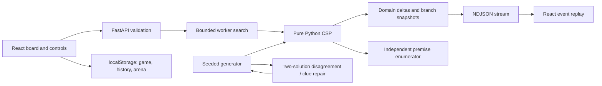

# Architecture

The production engine imports only Python's standard library. `Board` converts JSON into ordered runs and a cell-to-run graph, validating dimensions, distinct feasible clues, run lengths and connected membership. The same model validates every returned complete solution.

`core/model.py` owns structure and local/complete validation. `solver/constraints.py` caches distinct digit combinations and enumerates supported tuples. `solver/engine.py` implements seven configurations, immutable child copying, actual metrics, cancellation and budgets. `techniques.py` emits ranked local proof certificates. `verifier.py` imports neither engine nor techniques and enumerates its own premise tuples. `diagnose.py` performs breadth-first deduction refutation and minimum-cardinality clue-core search under fixed player entries. `replay.py` reconstructs domains and deterministic explanation text.

`generator/generate.py` builds connected masks, colors intersecting runs, derives clues, counts two solutions and edits a disagreement cell if ambiguous. The witness digit edit changes its two clue sums consistently; re-counting establishes uniqueness. `difficulty.py` scores real human traces against per-size empirical thresholds when available.

REST handles library, play feedback, hints, diagnosis, generation and fair arena runs. `/api/solve/stream` uses a two-worker executor and a bounded queue. Disconnect sets a cancellation event; tuple recursion checks it. Ordinary API CPU work uses FastAPI's synchronous endpoint thread pool. This protects the event loop but does not promise multicore CPU scaling under Python's GIL.

Frontend `store.js` holds pure history/replay operations; `useGame` handles persistence and timer; `Board` handles clue geometry and keyboard interaction; `Timeline` inspects real events; individual page modules own the game and research flows. All assets use local JavaScript/CSS and system fonts. No login, telemetry, external LLM, or runtime cloud API is used.
