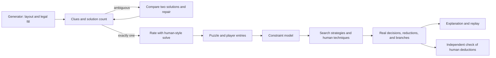

# Kakuro AI Lab: A Guide to the Ideas Behind the Project

*A plain-language reference for understanding the project again later.*

This guide explains the ideas the project uses, why they matter, and how they fit together. It is written for someone who wants to understand and present the system without needing to memorize its source code. The focus is on concepts and evidence; routine framework details and individual code variables are left out.

> **Project snapshot:** This describes the repository and recorded evidence as of 15 November 2026. Benchmark numbers and generation behavior can change if the code, machine, or experiment settings change.

## How to use this guide

If you have only a few minutes, read **The whole project in one picture**, **The AI methods**, **The two main contributions**, and **What the results really mean**. For a deeper refresher, follow the guide in order. The glossary at the end is designed for a quick reread before a presentation.

## The whole project in one picture

Kakuro AI Lab is both a playable number puzzle and a small laboratory for studying how a computer solves constraint problems. A puzzle is converted into a mathematical model. Several solving strategies operate on that model. The system records their real decisions so a person can inspect and replay them. A separate checker tests the human-style solver's deductions. The generator creates candidate puzzles and uses the solver to check whether they have exactly one answer and to estimate how difficult they are.



The app works locally after installation. The reasoning engine is custom Python and does not call an external AI service. In this project, “AI” means algorithms that search and reason over rules; it does not mean a language model that chats or learns from a huge training set.

## 1. Kakuro: the game rules

Kakuro looks a little like a crossword filled with digits. Black clue squares identify a horizontal run (“across”) and/or a vertical run (“down”). Fill each white square with a digit from 1 through 9.

Every run must satisfy two rules:

1. Its digits add up to the clue for that run.
2. No digit repeats inside that run.

The same digit **can** appear in two runs that cross, because the no-repeat rule applies separately to each run.

For example, if a two-cell run has clue 3, its cells must contain 1 and 2 in some order. They cannot be 3 and 0: zero is not allowed. They cannot be 1 and 1: repeats are forbidden. A clue is therefore more than a target sum; the run also has a distinct-digit rule.

Each white cell belongs to one across run and one down run. Its value must satisfy both at once. Those crossings are what make the puzzle interesting: a clue can narrow a cell, and the crossing clue can narrow it further.

## 2. The CSP idea: turn the puzzle into variables and rules

A **constraint satisfaction problem**, or **CSP**, is a problem described by three ingredients:

| CSP ingredient | Kakuro meaning | Example |
|---|---|---|
| Variable | A white cell whose value is unknown | `X(2,3)` means row 2, column 3 |
| Domain | The values that variable is currently allowed to take | `{2, 5, 8}` |
| Constraint | A rule that related variables must obey | This run sums to 14 and has no repeats |

At the start, each white cell's domain is `{1,2,3,4,5,6,7,8,9}`. As the solver reasons, it removes values that cannot work. If a cell's domain becomes `{6}`, then 6 is forced: no other value remains possible under the current deductions.

One across or down run is a constraint over several variables. It checks the sum and the no-repeat rule together. A cell participates in two such constraints, so the solver passes information between crossing runs.

### What does “consistent” mean?

A partial board is **locally consistent** if it has not yet broken an obvious rule: for example, it has no repeated assigned digit in a run and has not already exceeded the clue sum. This is useful for rejecting bad guesses early. But passing a local check does not prove that the rest of the puzzle can be completed.

A complete board is **valid** only if every white cell is filled and every across and down run satisfies both rules. The engine checks completed solutions against all runs. A puzzle can also have zero, one, or several valid complete boards; this is a separate question from whether a particular partial board looks locally okay.

### Puzzle structure checks

Before solving, the project checks that the board is structurally usable: dimensions and clue placement make sense, runs have legal lengths and feasible sums, every white cell belongs to an across and a down run, and the white-cell structure is connected. These checks catch malformed input early. A structurally valid puzzle is not necessarily uniquely solvable; uniqueness requires searching for solutions.

## 3. The AI methods

The professor's requirement is to apply several AI algorithms and compare their results. This project exposes seven solver configurations. They share the same puzzle rules, but choose cells, choose values, and reduce domains in different ways. That makes the comparison meaningful: it is an **ablation study**, where features are added or changed to observe their effect.

### 3.1 Backtracking search

Backtracking is the basic search pattern behind the solvers. The computer picks an empty cell, tries a candidate digit, and continues. If a rule becomes impossible to satisfy, it returns to the most recent choice, undoes it, and tries another option.

Think of filling a maze: follow one path; when it ends at a wall, step back to the last fork and take a different path. In the puzzle, a “wall” is a contradiction such as a run whose remaining cells cannot reach its sum.

The baseline solver uses a fixed cell order and tries digits in ascending order. It is a useful reference point, but its order may make poor choices. Backtracking can be exponential in the worst case: with `n` unknown cells and up to nine choices each, a crude upper bound is `9^n` possibilities. Good pruning and choices often make real instances much smaller, but there is no general guarantee that every puzzle is quick.

### 3.2 MRV: choose the most constrained cell

**Minimum Remaining Values (MRV)** chooses the unfilled cell with the fewest currently legal candidates. If one cell can only be 4 or 7 while another can be any of six digits, try the two-choice cell first.

Why? A tightly limited cell is more likely to reveal a contradiction soon. If its two choices both fail, the solver avoids spending time building a large branch around a doomed assignment. MRV chooses **which cell** to work on; it does not itself decide the right digit.

### 3.3 Degree: break a tie by influence

Sometimes two cells have the same number of candidates. The **degree heuristic** breaks that tie by preferring the cell connected to more still-unfilled neighboring cells through shared runs. Such a cell can influence more unresolved decisions, so inspecting it may reveal more information sooner.

Degree is a tie-breaker after MRV in this project. It does not mean a cell has a larger digit or a larger clue.

### 3.4 LCV: try the least disruptive value first

**Least Constraining Value (LCV)** chooses the order in which to try the candidates of the selected cell. It prefers the value that rules out the fewest candidates in directly related unfilled cells. The idea is to keep options open for the rest of the puzzle.

LCV is a search-order preference, not a proof that the preferred value is correct. If it leads to a dead end, backtracking tries another candidate.

### 3.5 Constraint propagation: remove impossible candidates early

Search asks “what if this cell were 5?” **Constraint propagation** instead asks each run, “which candidates still have support in a legal assignment for this run?”

For a run, the engine considers feasible ordered assignments that respect current domains, the clue sum, and distinct digits. A candidate has **support** if at least one such assignment uses it. Candidates with no support can be removed. Since a cell belongs to two runs, a reduction from one run may cause another run to prune more values. The process repeats until no domain changes: this is a **fixed point**.

This is often called generalized arc consistency (GAC) for these run constraints. In plain terms, every retained value must still have at least one locally legal way to complete each run it belongs to. This is stronger than checking only partial sums and duplicates. It still does **not** prove that all runs across the entire board can be satisfied together; search may still be needed.

Propagation can eliminate many branches, but checking all supported tuples costs work. It may use more time per search node than a simpler method. Therefore, fewer nodes do not automatically mean faster runtime.

### 3.6 The configurations compared

| Configuration | Main idea |
|---|---|
| Baseline | Fixed cell order, ascending values, basic partial-run checks |
| MRV | Choose the cell with fewest legal candidates |
| Degree | MRV, then prefer the more connected cell on a tie |
| LCV | MRV and degree, then try the least disruptive value first |
| Propagation | Fixed cell order plus run-tuple support pruning |
| Full CSP | Propagation, MRV, degree, and LCV together |
| Human | Apply ranked human-style deductions; make explicit guesses only when stuck |

The labels are configurations, not seven unrelated puzzle rules. Baseline, MRV, Degree, and LCV are useful for studying search order. Propagation and Full CSP show the effect of stronger domain pruning. Human is designed for readable reasoning and does not have directly comparable “work” metrics in every column.

## 4. The human-style solver and its explanations

The Human solver tries a catalogue of named deductions from easier to harder. It applies an available technique, updates candidate domains, and repeats. If no listed deduction applies, it makes an explicit guess and records that assumption so later reasoning can be understood as conditional on it.

The implemented catalogue is:

1. **Unique-combination run:** a clue and run length may allow only one set of digits. For example, length 2 and sum 3 forces the set `{1,2}`.
2. **Minimum/maximum bounds:** the smallest or largest possible remaining sum may show that some candidates cannot work.
3. **Combination-set pruning:** remove a cell candidate that appears in no feasible digit combination for its run.
4. **Run intersection:** pass restrictions between the across and down runs that meet at a cell.
5. **Naked pairs/triples:** if a small group of cells in one run can use only the same two or three digits, those digits are unavailable to other cells in that run.
6. **Hidden single:** if a digit is mandatory in every feasible combination for a run and only one cell can take it, that cell must contain it.
7. **Cross-run combination elimination:** use support from intersecting run combinations to rule out candidates that cannot participate in a consistent crossing.

These techniques express different ways of combining the same underlying rules. The labels help a person follow the style of deduction. They are not magic facts supplied by a language model.

### Proof-carrying deductions

For each human-style reduction, the solver records the relevant clue/run scope, the candidate domains it used, the technique name, and the resulting reduction. This record is a **certificate**: it contains enough local evidence for a checker to examine the deduction.

The project has a separate verifier that independently enumerates legal assignments for the stated premise runs and checks whether the claimed candidate removal is actually entailed. It does not reuse the technique implementation. This reduces the chance that the solver and checker repeat the same logic error.

The scope of the claim matters. The verifier checks certified human reductions and forced announcements against their premises and replay state. It does not prove that a guess is true; deductions after a guess are conditional on that guess. It also does not semantically prove every explanatory event: some non-mutating event descriptions are checked for structure rather than independently re-derived. So describe this as **verified deduction steps**, not as a formal proof of every timeline sentence or of global uniqueness.

## 5. Contradictions, counting, and backtracking

A **contradiction** means the current assumptions cannot satisfy a rule. Examples include a run with no feasible assignments left, or a cell with an empty domain. A contradiction under one branch means “this branch fails,” not necessarily “the puzzle has no solution.” The solver may backtrack and find another branch.

To check uniqueness, the solver counts solutions up to two:

- It finds none after exhaustive search: the puzzle is unsatisfiable.
- It finds one and exhausts the remaining search: the solution is unique.
- It finds two: the puzzle is ambiguous; at least two solutions exist.

The search can also hit a time or node limit. In that case the result is **inconclusive**. Not finding a second solution before a limit is not evidence that no second solution exists. Not finding any solution before a limit is not proof of unsatisfiability. The generator follows this distinction and does not return a puzzle as verified unique unless the count actually finishes with exactly one solution.

## 6. Explainability: traces and replay

The solvers emit real events such as candidate removal, assignment, heuristic choice, branch, contradiction, backtrack, and solved state. These records are based on the engine's actual state transitions. The interface can use them to explain why a cell was selected, show what changed, and replay earlier states.

**Replay** means reconstructing the solver's domain/board state from recorded changes and snapshots. Stepping backward restores an earlier state; stepping forward reapplies the next change. It is more informative than an animation that merely pretends to show reasoning.

There are two distinct kinds of run worth remembering:

- A **deduction** follows from the current constraints and recorded premises.
- A **guess/branch** is an assumption explored by search. It may later be rejected by a contradiction and undone.

Keeping those separate helps you explain the system honestly: search can solve a puzzle even when a human-style deduction catalogue gets stuck, but a guess is not a theorem.

## 7. “Why is this wrong?” diagnosis

When a player's entry is incompatible with the puzzle, the diagnosis feature tries to explain the conflict using the human technique catalogue. It explores possible deduction steps breadth-first, meaning it checks chains with fewer steps before chains with more steps. If it reaches a contradiction, the returned chain is shortest **within the implemented technique/application search graph**, including the final contradiction step.

The diagnosis has bounded time and state budgets. If those budgets run out, the right result is inconclusive. Also, “shortest” has a specific scope: it is not a claim that the explanation is the shortest possible mathematical proof using every imaginable Kakuro technique.

A separate search can find a minimum-cardinality set of clues that remains contradictory under the player's fixed entries. It tests clue subsets from smaller to larger. This means fewest clues **conditional on those entries**; it is not a minimum joint set of clues and player assumptions.

## 8. Puzzle generation and ambiguity-guided repair

The generator's job is harder than drawing a board. It must produce a legal Kakuro structure, clues, and (when requested) a puzzle that is actually unique and rated.

### Generation pipeline

1. Make a connected layout of white cells and clue cells with valid runs.
2. Construct a legal filled witness: every run uses digits 1–9 without repeats.
3. Derive each clue by summing its witness run.
4. Count solutions, stopping once two are found.
5. If there are two solutions, compare them to find cells where they disagree.
6. Try a targeted clue repair based on a legal witness digit at a disagreement cell, update the two affected clues, then count again.
7. Accept only after the actual count completes with exactly one solution and the human-style rating completes.

The witness fill is a way to construct a valid answer and clues; it is **not** proof of uniqueness. Only the solution-counting pass can establish uniqueness. A repair is an informed attempt to remove ambiguity, not a guarantee that every edit will work or that the final change is globally minimum.

For larger sizes, the generator uses connected short-run layouts to keep enumeration manageable. In repair mode, if ordinary attempts fail, the current policy can spend a reserved part of the overall time budget on one fresh constructive recovery. It still runs real solution counting and difficulty rating. Random mode does not silently use this recovery. A request can still fail or miss its target difficulty within the allotted time; the response should say so.

### Why compare two solutions?

If two complete boards satisfy all clues, the puzzle is ambiguous. Cells where they differ identify where the ambiguity shows up. Targeting one such cell for repair is more informed than blindly throwing away the whole puzzle and starting over. The clue sums that cross the edited cell must also be updated consistently, and the candidate must be counted again. This approach aims to preserve useful work; it does not promise a mathematically minimum edit.

## 9. Difficulty: measure solving effort, not appearance

Counting clues is a poor universal difficulty measure. Two boards with the same number of clues can behave very differently: one may expose forced values immediately, while the other may require long chains of deductions or guesses.

This project rates a puzzle using the Human solver's actual trace:

```text
difficulty score = sum of technique ranks
                  + 10 × deepest guess level
                  + 0.5 × number of technique applications
```

Harder-ranked techniques add more; deeper guessing adds a substantial penalty; the small step term distinguishes puzzles with otherwise similar technique ranks. These weights are a design choice, not learned from a large population of human players.

For 5×5 and 6×6, labels are based on empirical quintile cutoffs from 200 accepted unique puzzles per size. A **quintile** divides the observed sample into five equal-sized groups. Thus the labels are relative to this generator/sample and size; “Expert” is not a universal human-difficulty standard. Sizes 7–12 currently use provisional thresholds and should be described as uncalibrated.

## 10. Experiments and how to interpret the evidence

An experiment is only useful if you know which inputs were compared, what each metric counts, and what it leaves out. The repository retains raw results and methodology so tables can be checked.

### Solver comparison (ablation)

The recorded arena study ran seven configurations on the same ten built-in 6×6 puzzles: 70 runs. Each run used the same 100,000-node and 3-second caps, with tracing disabled. Recorded totals:

| Strategy | Nodes | Backtracks | Checks | Total time (ms) |
|---|---:|---:|---:|---:|
| Baseline | 12,664 | 12,536 | 57,072 | 255.91 |
| MRV | 293 | 165 | 31,845 | 86.86 |
| Degree | 233 | 105 | 22,967 | 63.13 |
| LCV | 268 | 140 | 32,122 | 88.77 |
| Propagation | 18 | 4 | 657 | 68.75 |
| Full CSP | 18 | 3 | 978 | 68.17 |
| Human | 18 | 3 | 710 | 61.45 |

On this sample, the heuristics and propagation dramatically reduced search nodes and backtracks compared with the baseline. Full CSP used the fewest nodes among the counted search methods, while propagation is computationally heavier per node. Human's “checks” count accepted certificate premise scopes and omit unsuccessful technique-catalogue search, so that column is not comparable as a total-work measure. Other strategies' checks are high-level run calls, not primitive arithmetic operations. Human reasoning is better described alongside technique steps and guess depth.

The table aggregates ten puzzles and shows one timing per run. Timing can vary with machine load. Fewer nodes is not the same thing as less elapsed time. The time excludes board parsing, UI/network, JSON serialization, replay, and proof checking; solver lab trace timings have different overhead. Use this table to discuss observed results under this setup, not to claim one algorithm is always fastest.

### Historical repair-versus-random generation experiment

The stored paired experiment has 200 seeds for each of sizes 5×5 and 6×6, in repair and random modes (800 attempts total). It measured:

| Size | Repair success | Random success | Repair mean time (ms) | Random mean time (ms) |
|---|---:|---:|---:|---:|
| 5×5 | 97% | 50.5% | 104.88 | 217.71 |
| 6×6 | 68% | 5% | 283.98 | 583.53 |

These figures describe the **historical pre-recovery generator policy** in the frozen records. Today's repair mode includes a reserved constructive recovery phase, so the old results must not be presented as a direct measurement of current policy. Repair and random share a seed, but their random streams diverge after method-specific actions; repair can also make up to 20 edits where random regenerates. These measurements are specific to their settings and do not establish that repair causes a universal improvement in all conditions.

### Difficulty and search effort

The recorded Spearman rank correlation between the human-style difficulty score and baseline search nodes is approximately **0.778** across 400 accepted puzzles, with a very small reported p-value. Spearman correlation measures whether two quantities tend to move in the same rank order; it does not require a straight-line relationship. This is evidence of association in that dataset, not proof that the score causes search effort. Board size may partly explain the relationship, and human difficulty was not independently validated with a player study.

### Current generator audit and independent cross-check

The final recorded audit re-requested puzzles at sizes 5–12 for seeds 0–9: 80 out of 80 returned puzzles were independently re-counted as unique within the recorded three-second check, four used constructive recovery, and the slowest request took 2,271 ms. This is a useful regression sample, not a universal guarantee for every seed or machine. A separate OR-Tools CP-SAT formulation cross-checked 300 seeded unique 5×5 samples in tests. OR-Tools is only an independent test oracle, not part of the shipped solving engine. The oracle and custom solvers share the board parser, so the check is independent in solving formulation but not in all input parsing.

The final audit also recorded 345 backend tests, 13 frontend tests, 698/733 statements (95.23%) in the measured core coverage set, a frontend production build, and a live HTTP smoke check. These are repository audit results, not a claim that every possible UI/device/accessibility scenario has been tested. Browser/mobile/accessibility QA was still incomplete in the recorded audit.

## 11. Application concepts in everyday terms

You do not need to memorize the framework names, but a few software concepts help explain how the pieces cooperate:

- **Frontend:** the browser interface the player sees: board, controls, explanations, and charts.
- **Backend/API:** the local service that receives a request, validates it, and asks the engine to solve, diagnose, or generate. An API is a defined way for the interface and service to exchange requests and results.
- **Engine:** the rule and search machinery. It can solve without depending on the visual interface.
- **Event stream:** a sequence of solver events sent as they happen during a longer run, so the interface can show progress instead of waiting for one final answer.
- **Local storage:** browser-managed storage for game state and history on the user's device. The application does not require an account or external database for this feature.
- **Seed:** a number that initializes repeatable pseudo-random choices. The same seed can help reproduce a generation attempt under the same code and settings; it does not make timing identical across machines.
- **Independent oracle:** a second implementation used in tests to cross-check answers. Agreement increases confidence, though shared parsing and finite samples mean it is not a proof about every conceivable input.

The browser interface, service, and solver have separate responsibilities. This separation makes the engine easier to test and lets the same reasoning power the game, solver lab, generator, and arena.

## 12. End-to-end examples

### Example A: solve a puzzle

1. The board is checked and translated into one variable per white cell, candidate domains, and across/down run constraints.
2. A selected strategy chooses a cell and candidate order. Propagation, where enabled, first removes values with no legal support in their runs.
3. Forced values are assigned; unresolved choices become search branches.
4. If a branch creates a contradiction, the solver restores the prior state and tries another value.
5. A complete board is checked against every clue. Events are replayable, and certified human deductions can be independently checked.

### Example B: make a verified puzzle

1. The generator makes a connected layout and legal filled witness.
2. It computes clue sums from that fill and counts solutions.
3. If it finds a second solution, it compares the two and tries a targeted repair.
4. It repeats the real count. It accepts the board only if the search finishes with one solution, then runs the human solver to estimate difficulty.
5. If time runs out at any required verification step, it does not label an unverified puzzle as unique.

### Example C: compare algorithms fairly

Give every strategy the same puzzle and the same node/time cap. Compare shared measures such as nodes, backtracks, and elapsed time, while noting that internal “checks” may count different things. Repeat timing runs if close speed differences matter. Interpret the result as evidence for the tested puzzles and settings.

## 13. What the project does not claim

These boundaries make a presentation more credible:

- It is not a learned model; the solver follows explicit rules and search algorithms.
- A preferred heuristic value is not guaranteed correct; search can backtrack.
- A valid witness is not evidence of uniqueness; a completed solution count is.
- A timeout or node limit is inconclusive, not a proof of “no solution” or “unique.”
- A verified deduction is conditional on its recorded premises and any earlier guesses.
- “Shortest explanation” is shortest in the bounded, implemented technique graph, not among every possible proof.
- Difficulty labels are relative to recorded samples, especially provisional for sizes 7–12.
- Historical generator rates do not measure the current recovery-enabled policy.
- Benchmark tables compare this sample and metric setup; they do not prove universal speed rankings.

## 14. Glossary for future-you

| Term | Plain meaning |
|---|---|
| Assignment | Giving a cell one digit |
| Backtracking | Undo a failed choice and try another |
| Branch | One assumed choice explored by search |
| Candidate | A digit still allowed for a cell |
| Constraint | A rule that values must satisfy |
| Constraint propagation | Repeatedly remove candidates that cannot fit a local rule |
| Contradiction | The current assumptions cannot satisfy a rule |
| CSP | A problem described by variables, domains, and constraints |
| Domain | The current set of possible values for a variable |
| Degree heuristic | Prefer the tied cell that affects more unresolved neighbors |
| Fixed point | Repeating reductions until another pass changes nothing |
| GAC / tuple support | Keep a value only if it appears in a legal assignment for each related run |
| Heuristic | A useful choice rule that guides search but is not a guarantee |
| LCV | Try first the value that removes the fewest neighbor options |
| MRV | Choose the unfilled cell with the fewest legal options |
| Naked pair/triple | Two/three cells share only those same two/three digits in a run |
| Proof certificate | Recorded premises and conclusion that a separate checker can inspect |
| Replay | Reconstruct prior solver states by applying or undoing recorded changes |
| Run | Consecutive white cells governed by one across/down clue |
| Solution count up to two | Enough search to distinguish none, unique, and multiple solutions |
| Uniqueness | Exactly one complete board satisfies every rule |
| Witness fill | A constructed legal completed board used to derive clues |

## 15. A short explanation you can say aloud

“We model every empty Kakuro cell as a variable with candidate digits, and each across/down run is a constraint requiring a target sum and no repeated digits. We compare backtracking strategies with MRV, degree, and LCV, and add tuple-based constraint propagation to remove unsupported candidates. Our human-style solver applies named deductions and records their premises so a separate checker can verify those reductions. The generator uses a legal witness to derive clues, counts solutions, and targets disagreements between solutions when repairing ambiguity; it only calls a puzzle unique after exhaustive counting finds exactly one. Results are measured on stated samples and limits, so we report the metric caveats and calibration boundaries too.”

## Where to continue in the repository

- [README](../README.md) — project overview, use, features, and recorded evidence.
- [Algorithm walk-through](algorithms.md) — search, certificates, diagnosis, and generation details.
- [Architecture](architecture.md) — how the interface, service, engine, trace, and verifier connect.
- [Benchmarking methodology](benchmarking.md) — how to reproduce and interpret recorded measurements.
- [Generator reliability notes](generator-reliability.md) — why generation failed before, what changed, and what the verification means.

When updating this guide, check the current code and raw results before changing any number or claim. In particular, keep historical pre-recovery generation results clearly separate from measurements of the current policy.
